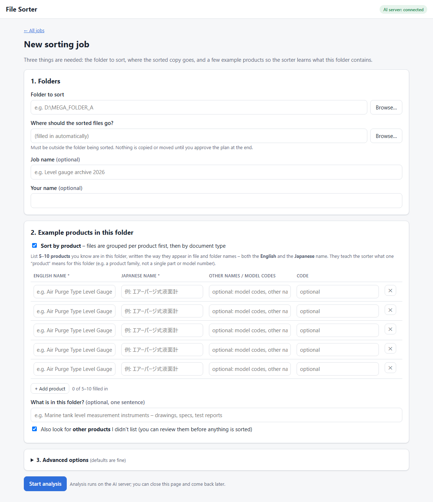
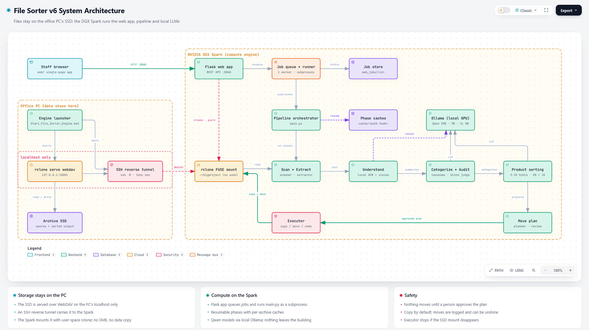

# 📁 File Sorter

**Turn a messy archive of tens of thousands of files into a clean, product-by-product folder tree, using local AI that reads every document, in English and Japanese.**

> The source code is in a **private** repository. This page describes the project, how it works, and what it can do.



---

## The problem

Engineering companies build up huge shared drives over the years: 60,000+ files and 4,000+ folders of drawings, specifications, manuals, test reports, scanned PDFs, photos and software backups. The folder names are in Japanese, the structure grew by accident, and nobody can find anything.

Sorting that by hand takes months. Keyword rules break on the first misspelling. Cloud AI isn't an option for confidential documents.

## What File Sorter does

- 📖 **Reads each file:** text from PDFs and Office files, local OCR for scanned documents, and a vision model for drawings and photos.
- 🗂️ **Finds the document types in your archive:** specifications, drawings, manuals, reports… The categories come from the data, not from a fixed list.
- 🏷️ **Sorts by product:** you give it 5–10 example products, and it learns what a "product" means in *this* archive.
- ✅ **Checks its own accuracy:** an independent AI re-checks a random sample of files and reports how often it agrees.
- 🛡️ **Never touches a file without approval:** you review a full plan first, then choose **Copy** (originals untouched) or **Move** (can be undone).
- 🔒 **Runs 100% on-premise:** all AI runs on a local GPU server, and no document leaves the building.

The result looks like this:

```
Sorted/
├─ Air_Purge_Type_Level_Gauge/
│   ├─ Product Specifications/
│   ├─ Design Drawings/
│   └─ Quality Reports/
├─ Level_Switch/
│   └─ User Manuals/
├─ Common/              ← documents about the company / several products
├─ Unknown_Product/     ← couldn't be attributed → human review
└─ _Not_Needed/         ← junk (moved aside, never deleted)
```

---

## Built for non-programmers

Staff sort archives from a **web browser**, not the command line:

1. **New job:** pick the folder, then type 5–10 example products (English + Japanese names).
2. **Analyze:** a live progress bar shows each step, with a time estimate. You can close the tab; the work continues.
3. **Review:** check and edit the document categories and product list the AI proposes.
4. **Plan:** see the new folder tree, accuracy scores and flagged sensitive files, and download the plan for Excel.
5. **Apply:** copy or move the files. Existing files are never overwritten, and a move can be undone.

Jobs queue up automatically, and an interrupted job resumes where it stopped.

---

## How it works

<picture>
  <source media="(prefers-color-scheme: dark)" srcset="docs/architecture/architecture-dark.png">
  
</picture>

- **Office PC:** the archive SSD never leaves it. A launcher serves the folder over WebDAV on the PC's own localhost and opens an encrypted SSH reverse tunnel to the GPU server.
- **DGX Spark:** mounts that folder (no admin rights, no file copies) and runs everything else: the web app, the job queue, every pipeline phase, the file executor and the AI models.
- **Results** are written back to the same SSD, next to the original archive.

An interactive version (zoom, search, light/dark) is in [`docs/architecture/architecture.html`](docs/architecture/architecture.html): download it and open it in a browser.

The pipeline has resumable phases. Every phase caches its progress, so a crash or cancel loses nothing:

| # | Phase | What happens |
|---|---|---|
| 1 | **Scan** | Walk the tree and fingerprint every file |
| 2 | **Extract** | Pull text from PDF / Word / Excel / PowerPoint / text files, in parallel |
| 3 | **Understand** | Summarize each file: local OCR for scans, a vision model for images and drawings |
| 4 | **Categorize** | Map-reduce over all folders → document-type taxonomy → assign each folder, with a per-file fallback |
| 4c | **Audit** | A blind AI judge re-classifies a stratified sample and reports accuracy |
| 4p | **Product** | Hint-driven product attribution (below) |
| 5 | **Plan** | Build the full move plan; nothing is touched yet |
| 6 | **Apply** | Copy or move with a full log; moves can be undone |

### Product sorting from a few examples

Every archive holds a different product family, so nothing about the domain is hard-coded. From the **5–10 examples** the user provides, the system:

1. **Learns the domain:** what the company makes, what level of detail counts as one "product line", and which things are only parts or accessories of a product (those are never products themselves).
2. **Grounds its keywords:** it proposes synonyms, Japanese spelling variants and model codes, then keeps only the ones that actually appear in the archive's file and folder names.
3. **Matches exact names first:** product names in both languages and model codes are matched directly, ignoring full-width/half-width differences (`ｴｱｰﾊﾟｰｼﾞ` = `エアーパージ`, `ＮＳ９６７Ｆ` = `NS967F`). A folder named after exactly one product is settled without asking the AI.
4. **Asks the AI for the rest:** those folders go to the LLM with the keyword matches as evidence, and every prompt follows the same shared rules.
5. **Finds unlisted products:** it proposes products you didn't list, at the same level of detail as your examples. You review them before anything is sorted.

**Why it matters:** an earlier version, which had no examples to go on, split a 7-product catalogue into 44 "products" (mostly components and model numbers), and only 44.5% of its product assignments were confirmed by the audit. With examples, the first end-to-end test put every product-specific file under the right product, and the independent audit agreed on 93.8% of files. That test used a small 16-file set; full-archive numbers are being measured.

---

## Tech stack

| Layer | Technology |
|---|---|
| AI inference | Ollama on an NVIDIA DGX Spark (GB10, 128 GB unified memory) |
| Models | Qwen 3.6 35B (categories and products), Qwen 3.5 9B (summaries and audit), Qwen3-VL 8B (vision) |
| OCR | RapidOCR PP-OCRv5 (Japanese, Chinese, English), CPU |
| Parsing | PyMuPDF, python-docx, python-pptx, openpyxl |
| Backend | Python 3, Flask, subprocess job runner |
| Frontend | Plain HTML/CSS/JS: no build step, light and dark mode, mobile-friendly |
| Storage link | rclone (WebDAV) over an SSH reverse tunnel: the files stay on the office PC |

## Safety by design

- **Plan first, act later:** nothing moves until a human approves the plan.
- **Copy by default:** originals stay untouched; a **move** writes a log and can be undone.
- **No overwrites:** an existing file at the destination is skipped, never replaced.
- **Storage guard:** if the link to the archive drops, the engine stops rather than writing anywhere else.
- **Sensitive files flagged:** files that look like pricing, contracts or personal data are listed for review; their contents are never modified.
- **Junk is moved aside, never deleted.**
- **Windows long paths** (over 260 characters) are supported.

---

## Project status

🟢 In active use internally. Being rolled out to non-technical teams via the web app.

## Access

The code is private. For access or a demo, contact the maintainer through GitHub: [@Aryanacoder](https://github.com/Aryanacoder).
